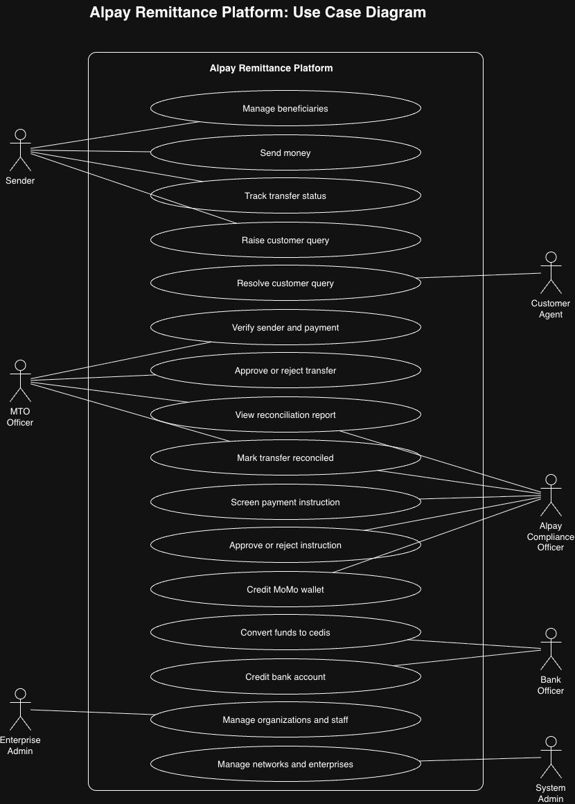
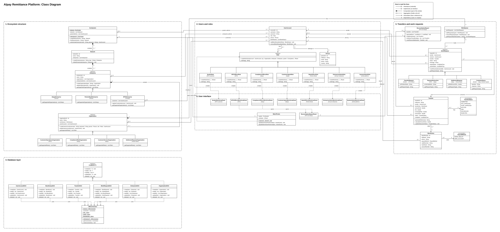

# Alpay Remittance Platform

A Java desktop application that connects a Canadian money transfer operator (MTO), Alpay and a Ghanaian partner bank on one shared platform, so that remittances from Canada to Ghana can be verified, screened, settled, paid out and reconciled through tracked work requests.

**Course:** INFO 5100 - Application Engineering & Development

**Student:** Bryne Abeiku Nyame

**Institution:** Northeastern University, Toronto

---

## Problem Statement

Sending money from Canada to Ghana involves three separate companies: a money transfer operator (MTO) that collects the sender's money in Canada, Alpay, a Ghanaian payment service provider, and a partner bank that converts the funds into cedis. Because these companies communicate through emails, spreadsheets and separate systems, transfers are delayed, senders can't track their money, queries are slow to resolve, and records often don't match.

This project builds a shared platform, operated by Alpay, where each step is handled as a tracked work request. Alpay sits at the centre: it receives payment instructions from the MTO, screens each transaction for fraud and compliance, sends settlement requests to the partner bank, credits mobile money wallets directly, resolves sender queries, and reconciles records with the MTO. The bank completes bank account payouts.

No company can complete a transfer alone: the MTO collects funds but can't pay out in Ghana, Alpay connects and controls the whole process but depends on the MTO for funds and the bank for currency conversion, and the bank converts currency but has no link to senders in Canada.

---

## Ecosystem Structure

**Networks:** Canada, Ghana

| Network | Enterprise | Organization | Role |
|---|---|---|---|
| Canada | MTO | Customer Operations | MTO Officer |
| Ghana | Alpay | Compliance and Risk | Alpay Compliance Officer |
| Ghana | Alpay | Customer Service | Alpay Customer Agent |
| Ghana | Partner Bank | Settlement and Payouts | Bank Officer |

**Other roles**

- **Sender:** a customer of the MTO who sends money to a beneficiary in Ghana
- **Enterprise Admin:** one per enterprise; manages its organizations and staff accounts
- **System Admin:** manages the whole platform, its networks and enterprises

---

## Work Requests

| # | Work Request | From | To | Type |
|---|---|---|---|---|
| 1 | Transfer Request | Sender | MTO Officer | Within enterprise |
| 2 | Payment Instruction | MTO Officer | Alpay Compliance Officer | Between enterprises |
| 3 | Settlement Request | Alpay Compliance Officer | Bank Officer | Between enterprises |
| 4 | Customer Query | Sender | Alpay Customer Agent | Between enterprises |
| 5 | Reconciliation Report | MTO Officer and Alpay Compliance Officer | — | Data view and update |

---

## How a Transfer Works

1. **Initiation:** the Sender enters the amount, beneficiary details and payout method (MoMo wallet or bank account) and submits a transfer request.
2. **Verification:** the MTO Officer checks the sender (KYC, sanctions, AML), confirms payment of the amount and fees, and approves or rejects.
3. **Transmission:** on approval, the system generates a unique transaction reference and sends a payment instruction to Alpay.
4. **Screening:** the Alpay Compliance Officer validates the beneficiary, screens for fraud and AML, and approves or rejects.
5. **Settlement:** Alpay sends a settlement request to the Partner Bank, where the Bank Officer confirms the funds and converts them into cedis.
6. **Payout:** the Bank Officer credits bank accounts; Alpay credits MoMo wallets once settlement is confirmed.
7. **Reconciliation:** the MTO Officer and Alpay Compliance Officer review the reconciliation report and mark each transfer as reconciled.

**Transfer status:** Submitted → MTO Approved → Alpay Approved → Settled → Paid → Reconciled (Rejected is possible at either approval step)

At any point, the Sender can raise a customer query, which is handled by the Alpay Customer Agent.

---

## Use Case Diagram

## Class Diagram

The class diagram is organized into five zones. Tags in curly braces under a class name show which enterprise it belongs to. The full list of classes, attributes, methods and relationships is in the [class diagram specification](docs/diagrams/class-diagram-spec.md).

1. **Ecosystem structure:** `EcoSystem` (a singleton) contains the Canada and Ghana `Network`s. Each network contains enterprises: the abstract `Enterprise` class has three subclasses, `MTOEnterprise`, `AlpayEnterprise` and `PartnerBankEnterprise`. Each enterprise contains organizations, and the abstract `Organization` class has four subclasses, one per department.
2. **Users and roles:** every `UserAccount` belongs to a `Person` and has exactly one `Role`. The abstract `Role` class has seven subclasses, each overriding `createWorkArea()` so that every user sees their own screen after logging in (polymorphism).
3. **Transfers and work requests:** a `Transfer` pays one `Beneficiary` by MoMo wallet or bank account and always has one `TransferStatus`. Each step is a `WorkRequest` (abstract) with four types: `TransferRequest`, `PaymentInstruction`, `SettlementRequest` and `CustomerQuery`. Requests are held in each organization's `WorkQueue`, and the `ReconciliationReport` checks transfers for mismatches and delays.
4. **Database layer:** the `CrudDAO` interface defines create, read, update and delete; six DAO classes implement it and use a single `DBConnection` (a singleton) to connect to MySQL.
5. **User interface:** `MainJFrame` handles login, each role opens its own work area panel, and the MTO Officer and Alpay Compliance Officer share the `ReconciliationReportPanel`.

**OOP concepts used:** abstract classes, inheritance, interfaces, polymorphism, encapsulation (private attributes) and the singleton pattern.

---

## Tech Stack

- Java (Swing / JavaFX)
- MySQL, hosted in Docker
- JDBC with MySQL Connector/J
- MySQL Workbench (database viewer)

---

## Setup Instructions

_To be added once the application and database are set up._

---

## Screenshots

### Application screens

_To be added._

### CRUD operations in MySQL Workbench

_To be added._
